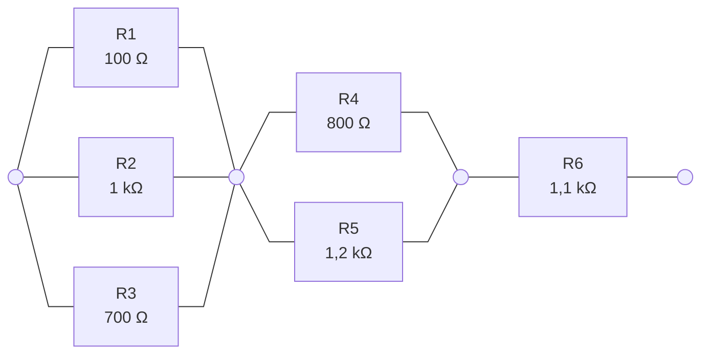

# TD 3 — Circuits composés et possession

On veut maintenant associer des composants en série et en parallèle, puis
combiner ces associations entre elles. Reprenez votre code du TD 2 ou
`checkpoints/s02`.

> [!TIP]
> Plusieurs exercices réutilisent les mêmes noms de variables. Pour garder vos
> essais précédents, placez chaque exercice dans sa propre fonction
> (`exercise1()`, `exercise2()`…) et appelez depuis `main` celle qui vous intéresse.

## 1. Un tableau qui connaît sa taille

À la fin du TD 2, `display_all` recevait un tableau et sa taille dans deux
paramètres séparés. Si on ajoute un composant au tableau en oubliant de changer
la taille passée à `display_all`, le programme compile sans rien signaler.

Remplacez le tableau par un
[`std::vector`](https://en.cppreference.com/cpp/container/vector) (`<vector>`) :

```cpp
void display_all(const std::vector<const Component*>& components, double frequency_hz);
```

Dans `main`, créez un vecteur contenant les adresses des trois composants,
puis créez une seconde résistance et ajoutez son adresse au vecteur avec
`push_back`. Appelez `display_all` : les quatre composants doivent s'afficher,
sans aucun changement dans la fonction.

> [!TIP]
> Un vecteur s'initialise comme un tableau : `std::vector<int> values = {1, 2, 3};`.
> `push_back` ajoute un élément à la fin et `size()` renvoie le nombre d'éléments.
> La boucle `for (const Component* component : components)` s'écrit comme pour
> un tableau.

Le vecteur est passé par référence constante. S'il était passé par valeur,
chaque appel à `display_all` travaillerait sur une copie du vecteur. Que
contiendrait cette copie ? Les composants eux-mêmes seraient-ils copiés ?

## 2. Une association en série

Des composants en série se comportent comme un seul composant, dont
l'impédance est la somme des leurs :

$$
Z_{eq}=\sum_k Z_k
$$

Une association en série est donc elle-même un composant. Créez une classe
`Series` dérivée de `Component`.

> [!TIP]
> Comme pour les classes précédentes, placez la déclaration dans
> `include/series.hpp` et les définitions dans `src/series.cpp`. Ajoutez
> `src/series.cpp` aux sources de l'exécutable dans `CMakeLists.txt`.

Comme le vecteur de l'exercice 1, la série garde l'adresse des composants
qu'on lui donne, dans un champ privé de type `std::vector<const Component*>`.
On doit pouvoir écrire :

```cpp
Resistor r1("R1", 1000.0);
Resistor r2("R2", 2000.0);

Series series("S1");
series.add(r1);
series.add(r2);
```

> [!TIP]
> `add` reçoit une référence, mais le vecteur ne peut pas stocker de
> références : `std::vector<const Component&>` ne compile pas. C'est une limite
> du langage.

Le constructeur reçoit seulement un nom : une série est vide à sa création.
Écrivez `add`, puis redéfinissez `impedance` et `description`. La description
reprend celles des composants :

```text
S1 = Series(R1 (1000 ohm), R2 (2000 ohm))
```

> [!TIP]
> Il n'y a pas de virgule avant le premier composant. Une boucle avec un
> indice permet de traiter ce cas.

Vérifiez que l'impédance vaut 3 kΩ. Ajoutez ensuite à la série le condensateur
C1 de 100 nF : quelle impédance attendez-vous à 1 kHz ? Comparez avec votre
programme.

Pour l'instant, on suppose qu'une série contient au moins un composant quand
on calcule son impédance. Le cas du montage vide sera traité au TD 4.

## 3. En parallèle, puis les deux à la fois

Créez une classe `Parallel` sur le même modèle, avec la formule :

$$
Z_{eq}=\left(\sum_k\frac{1}{Z_k}\right)^{-1}
$$

Testez-la avec R1 et R2 : vous devriez obtenir environ 666,67 Ω. On choisit
ici des valeurs qui n'entraînent pas de division par zéro.

Construisez maintenant ce circuit :



Avant de coder, repérez les associations en série et en parallèle : votre
programme devrait créer un objet `Series` et deux objets `Parallel`.
Calculez l'impédance du circuit à la main (ou à la calculatrice), puis avec
votre programme. Vous devriez trouver environ 1660,46 Ω.

Avez-vous dû modifier `Series` pour qu'elle accepte un `Parallel` ? Pourquoi ?

> [!NOTE]
> Cette organisation porte un nom : le *motif composite*, vu en CM avec les
> dossiers et les fichiers.

## 4. Fabriquer un montage dans une fonction

On aimerait écrire une fonction qui fabrique un pont diviseur, c'est-à-dire
deux résistances en série :

```cpp
Series make_divider(double r1_ohm, double r2_ohm) {
    Resistor r1("R1", r1_ohm);
    Resistor r2("R2", r2_ohm);
    Series divider("Divider");
    divider.add(r1);
    divider.add(r2);
    return divider;
}
```

Dans `main`, récupérez le pont renvoyé par `make_divider(1000.0, 2000.0)` et
affichez son impédance.

Avant d'exécuter : que deviennent `r1` et `r2` à la fin de `make_divider` ?
Vers quoi pointent alors les pointeurs stockés dans le pont renvoyé ?

Compilez avec AddressSanitizer (voir
[l'installation](setup.md#4-vérifier-addresssanitizer)) et exécutez. Dans le
diagnostic, repérez la ligne de l'accès invalide, puis la fonction dans
laquelle l'objet lu avait été créé.

> [!NOTE]
> Le compilateur n'a rien signalé. Sans AddressSanitizer, le programme peut
> afficher 3000, une valeur fausse ou planter : son comportement est indéfini.

La série *observe* ses composants : elle sait où ils se trouvent, mais ne
décide pas de leur durée de vie. Le vecteur de l'exercice 1 observe lui aussi
des composants. Pourquoi ne pose-t-il pas de problème ?

Pour que `make_divider` fonctionne, le pont doit garder lui-même ses
résistances en vie, c'est-à-dire les *posséder*.

Première idée : stocker les composants par valeur. Dans un essai séparé,
déclarez un `std::vector<Component>` et essayez d'y ajouter `r1` avec
`push_back`.

> [!TIP]
> Le message commence par des lignes de la bibliothèque standard. Cherchez
> celle qui contient `abstract class type`.

Pourquoi le compilateur refuse-t-il ce vecteur ? Si `Component` n'était pas
abstraite, il compilerait : pourquoi ne conviendrait-il quand même pas ?

## 5. La série devient propriétaire

Il faut donc stocker des pointeurs, mais des pointeurs qui possèdent l'objet
pointé et le détruisent quand ils disparaissent. Vous en avez utilisé un au
TD 1. Dans `Series` et `Parallel`, remplacez le champ par :

```cpp
std::vector<std::unique_ptr<Component>> components_;
```

et la signature de `add` par `void add(std::unique_ptr<Component> component)`.

Dans `add`, essayez d'abord `components_.push_back(component);`. Vous avez
déjà rencontré cette erreur au TD 1 : quelle opération le compilateur
refuse-t-il ?

> [!TIP]
> Pour transférer l'objet à un autre `unique_ptr`, écrivez `std::move(component)`
> ([`std::move`](https://en.cppreference.com/cpp/utility/move), `<utility>`).
> `std::move` ne déplace rien à lui seul : il autorise l'opération qui le
> reçoit, ici `push_back`, à vider `component`.

Votre `main` ne compile plus : les composants se créent maintenant avec
`std::make_unique`, et la série en prend possession.

```cpp
Series series("S1");
series.add(std::make_unique<Resistor>("R1", 1000.0));
series.add(std::make_unique<Resistor>("R2", 2000.0));
```

Adaptez les essais des exercices 2 et 3 et vérifiez que vous retrouvez les
mêmes impédances. Pour le circuit de l'exercice 3, remplissez chaque
association en parallèle avant de la confier au circuit :

```cpp
auto p1 = std::make_unique<Parallel>("P1");
// Ajouter R1, R2 et R3 à p1.

Series circuit("Circuit");
// Transférer p1 à circuit, puis faire de même avec P2 et R6.
```

> [!TIP]
> Un `std::unique_ptr<Resistor>` se convertit en `std::unique_ptr<Component>`,
> comme un `Resistor*` se convertit en `Component*`.

Réécrivez enfin `make_divider` avec `std::make_unique`, puis relancez-la avec
AddressSanitizer. Le diagnostic a-t-il disparu ? Qui garde les résistances en
vie après la fin de la fonction ?

On suppose que `add` ne reçoit jamais de pointeur nul. Ce cas sera aussi
traité au TD 4.

## 6. Transférer un composant

Créez une troisième résistance dans une variable :

```cpp
auto r3 = std::make_unique<Resistor>("R3", 3000.0);
```

Essayez de l'ajouter à la série avec `series.add(r3)`. Le message parle de
conversion : le compilateur doit fabriquer le paramètre `component` à partir
de `r3`. De quelle opération aurait-il besoin pour cela ?

À l'exercice 5, `series.add(std::make_unique<Resistor>("R1", 1000.0))` était
pourtant accepté. Quelle différence y a-t-il entre `r3` et le résultat de
`std::make_unique` écrit directement dans l'appel ?

Ajoutez maintenant la résistance avec `series.add(std::move(r3))`. Que vaut
`r3` après l'appel ? Vérifiez-le avec un `assert`. La résistance R3
existe-t-elle encore ? Qui la possède ?

Reprenez le circuit de l'exercice 3 en inversant l'ordre : transférez `p1` à
`circuit`, puis essayez d'ajouter R1 à `p1`. Que se passe-t-il à l'exécution ?

## 7. Qui détruit les composants ?

Ajoutez temporairement un affichage dans le destructeur de `Component`. Avant
d'exécuter la construction du circuit de l'exercice 3, prédisez l'ordre des
affichages : le circuit annoncera-t-il sa destruction avant ou après celle de
ses composants ? Vérifiez, puis expliquez le résultat.

Vous n'avez écrit aucun `delete` : qui appelle le destructeur de R4 ?

Retirez l'affichage et revenez à `virtual ~Component() = default;`.

Essayez enfin de copier le circuit : `Series copy = circuit;`. Le message est
long ; cherchez la ligne qui contient `use of deleted function`. Pourquoi le
compilateur refuse-t-il cette copie ?

Avec la série de l'exercice 2, qui observait ses composants, cette copie
était acceptée. Qu'auraient partagé l'original et sa copie ?

Pourtant, `make_divider` renvoie un `Series` par valeur. Pourquoi est-ce
accepté ?

## Pour aller plus loin

### Consulter les composants

Ajoutez à `Series` et `Parallel` :

```cpp
std::size_t size() const;
const Component* child(std::size_t index) const;
```

`child` renvoie un pointeur observateur : le composant reste possédé par le
montage. Jusqu'à quand ce pointeur reste-t-il utilisable ?

Écrivez d'abord `child` avec `components_[index]`, puis appelez `child(2)` sur
une série de deux composants, avec et sans AddressSanitizer. Remplacez ensuite
`components_[index]` par `components_.at(index)` et recommencez. Lisez la
documentation de
[`operator[]`](https://en.cppreference.com/cpp/container/vector/operator_at)
et de [`at`](https://en.cppreference.com/cpp/container/vector/at) pour
expliquer la différence. Le message obtenu avec `at` vient d'une exception :
nous verrons au TD 4 comment l'intercepter.

### Dix résistances

Construisez avec une boucle une série de dix résistances de 100 Ω, 200 Ω, …,
1000 Ω, nommées R1 à R10. Vérifiez que votre programme trouve bien une
impédance de 5500 Ω. Calculez ensuite l'impédance de ces dix résistances
montées en parallèle, puis vérifiez que votre programme donne la même valeur.

### Le composant a-t-il bougé ?

Avant de transférer une résistance à une série vide, conservez l'adresse
renvoyée par `get()`. Après le transfert, comparez-la avec `child(0)`.

Ajoutez ensuite cent autres résistances : le vecteur a dû agrandir son
stockage plusieurs fois. L'adresse de la première résistance a-t-elle changé ?
Qu'est-ce que le vecteur a déplacé dans son nouveau bloc à chaque
agrandissement ?

### Deux circuits équivalents ?

Avec $R_1 = 1\,\mathrm{k\Omega}$, $R_2 = 2\,\mathrm{k\Omega}$ et
$R_3 = 3\,\mathrm{k\Omega}$, construisez $(R_1 \parallel R_2) \parallel R_3$
et $R_1 \parallel (R_2 \parallel R_3)$. Ces deux montages sont-ils équivalents
en théorie ?

Comparez leurs impédances avec `==`, puis affichez-les avec 17 chiffres
significatifs grâce à
[`std::setprecision`](https://en.cppreference.com/cpp/io/manip/setprecision).
Que constatez-vous ? Pourquoi les `assert` du TD 1 utilisaient-ils une
tolérance ?

### Sans destructeur virtuel

Retirez `virtual` devant le destructeur de `Component` et recompilez. Le
compilateur vous prévient-il ?

Exécutez avec AddressSanitizer un essai qui construit puis détruit une série.
Le diagnostic indique deux tailles : celle de l'objet alloué et celle de
l'objet libéré. À quelles classes correspondent-elles ? Vérifiez avec
`sizeof`, puis remettez `virtual`.

### Du code en double

`Series` et `Parallel` ont beaucoup de code en commun. Lequel ? Qu'est-ce qui
les distingue vraiment ?

Imaginez une classe intermédiaire entre `Component` et ces deux classes. Que
contiendrait-elle ? Serait-elle abstraite ? Écrivez-la si vous avez le temps :
les TD suivants fonctionnent avec ou sans elle.
