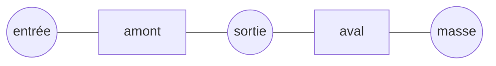
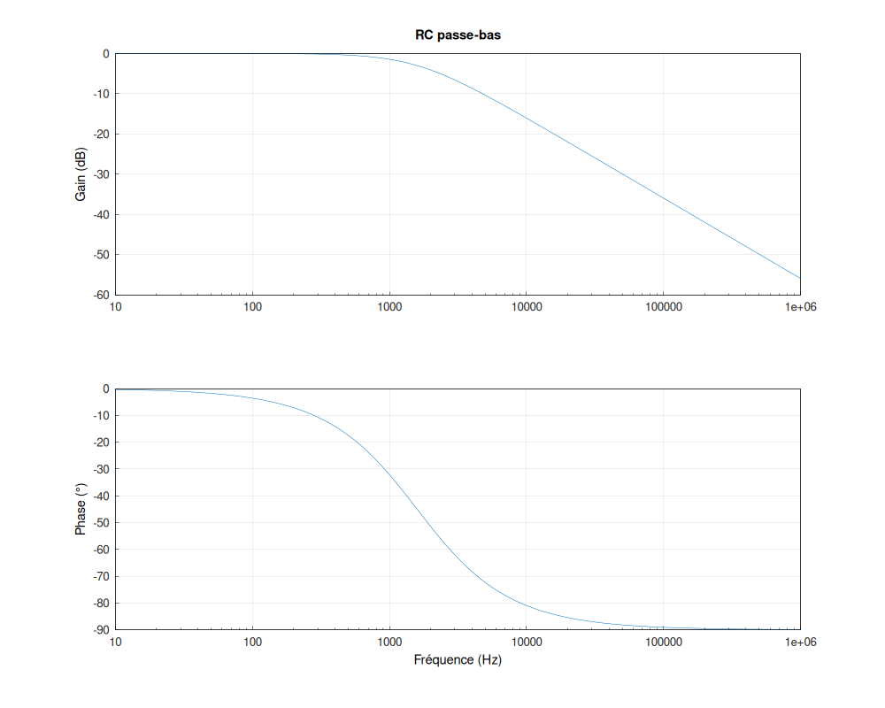

# TD 5 — Pont diviseur et diagramme de Bode

Jusqu'ici, on calcule l'impédance d'un composant ou d'un montage. Un filtre se
décrit autrement : par le rapport entre sa tension de sortie et sa tension
d'entrée. On va calculer ce rapport pour des ponts diviseurs, puis tracer leur
diagramme de Bode avec une bibliothèque externe. Reprenez votre code du TD 4 ou
`checkpoints/s04`.

## 0. Lancer la compilation de Matplot++

Le tracé utilise la bibliothèque [Matplot++](https://alandefreitas.github.io/matplotplusplus/),
installée avec vcpkg (voir [l'installation](setup.md#5-préparer-vcpkg--requis-seulement-à-partir-de-la-séance-5)).
Sa première compilation prend plusieurs minutes : lancez-la maintenant, elle
avancera pendant que vous travaillez sur les exercices suivants.

Copiez [`checkpoints/s05/vcpkg.json`](../checkpoints/s05/vcpkg.json) à la racine
de votre projet. Ce fichier liste les bibliothèques dont le projet a besoin.
Dans un second terminal, depuis ce dossier :

```bash
vcpkg install
```

vcpkg garde le résultat en cache : à l'exercice 6, CMake le retrouvera sans
tout recompiler.

> [!TIP]
> Si la commande `vcpkg` n'existe pas, suivez d'abord la partie 5 de
> l'installation, puis ouvrez un nouveau terminal.

## 1. Une interface pour les filtres

Pour une tension sinusoïdale de fréquence $f$, un filtre est décrit par sa
*fonction de transfert* :

$$
H(f) = \frac{U_{out}}{U_{in}}
$$

C'est un nombre complexe : son module donne le rapport des amplitudes, son
argument le déphasage de la sortie par rapport à l'entrée.

Le code qui trace un diagramme de Bode n'a besoin que de $H(f)$, quel que soit
le montage. Créez dans `include/transfer_function.hpp` une interface
`TransferFunction`, avec une seule méthode :

```cpp
virtual std::complex<double> response(double frequency_hz) const = 0;
```

> [!TIP]
> Comme `Component`, une classe qu'on utilise à travers un pointeur ou une
> référence vers la base a besoin d'un destructeur virtuel (CM 2).

Pourquoi ce fichier n'a-t-il pas besoin d'un `.cpp` ?

## 2. Un pont diviseur

Un pont diviseur est formé de deux composants en série entre l'entrée et la
masse. La sortie est prise entre les deux :



Si la source est idéale et que rien n'est branché sur la sortie, le même
courant traverse les deux composants, et :

$$
H(f)=\frac{Z_{aval}(f)}{Z_{amont}(f)+Z_{aval}(f)}
$$

Créez une classe `VoltageDivider` dérivée de `TransferFunction`. Son constructeur
reçoit le composant amont puis le composant aval, sous forme de
`std::unique_ptr<Component>` : le pont possède ses composants. Refusez les
pointeurs nuls, comme au TD 4.

`VoltageDivider` dérive de `TransferFunction` et contient deux `Component`.
Pourquoi ne dérive-t-il pas de `Component`, comme `Series` et `Parallel` ?

Commencez par un pont de deux résistances, R1 = 1 kΩ en amont et R2 = 2 kΩ en
aval. Quelle tension de sortie obtient-on pour 9 V en entrée ? Vérifiez que
`response` donne $2/3$ quelle que soit la fréquence.

Remplacez ensuite R1 par une série de deux résistances de 500 Ω : le résultat
ne doit pas changer. Avez-vous eu à modifier `VoltageDivider` ?

### Deux filtres RC

Avec R = 1 kΩ et C = 100 nF, construisez :

- un passe-bas : R en amont, C en aval ;
- un passe-haut : C en amont, R en aval.

Leur fréquence de coupure vaut :

$$
f_c=\frac{1}{2\pi RC}\approx1591{,}55\text{ Hz}
$$

À cette fréquence, le passe-bas doit donner $H = 0{,}5 - 0{,}5j$ : un module
de $1/\sqrt{2}$ et un argument de −45°. Vérifiez-le, puis vérifiez que le
passe-haut donne +45°.

> [!TIP]
> [`std::abs`](https://en.cppreference.com/cpp/numeric/complex/abs) et
> [`std::arg`](https://en.cppreference.com/cpp/numeric/complex/arg) donnent le
> module et l'argument (en radians) d'un `std::complex`.

Construisez le passe-bas à partir de deux variables :

```cpp
auto r = std::make_unique<Resistor>("R", 1000.0);
auto c = std::make_unique<Capacitor>("C", 100e-9);
VoltageDivider low_pass(std::move(r), std::move(c));
```

Essayez ensuite de construire le passe-haut avec ces mêmes variables `r` et `c`.
Que se passe-t-il ? Pourquoi faut-il créer de nouveaux composants pour le
second filtre ?

## 3. Un espace de noms

Le traceur fourni à l'exercice 6 désigne vos classes par `circuit::TransferFunction`,
`circuit::BodeData`, etc. Placez toutes vos classes et fonctions dans un espace
de noms `circuit`, dans les `.hpp` comme dans les `.cpp` :

```cpp
namespace circuit {

// déclarations ou définitions

} // namespace circuit
```

Dans `main.cpp`, écrivez ensuite `circuit::Resistor`, ou ajoutez
`using namespace circuit;` en haut du fichier.

> [!WARNING]
> Si un `.cpp` n'est pas dans l'espace de noms, ses définitions ne correspondent
> plus aux déclarations, et le compilateur indique par exemple
> `'Resistor' does not name a type` : hors de `circuit`, il n'y a plus de
> classe `Resistor`.

Pourquoi ne faut-il jamais écrire `using namespace circuit;` dans un `.hpp` ?

## 4. Des fréquences sur une échelle logarithmique

Un diagramme de Bode utilise une échelle logarithmique de fréquence : 10 Hz,
100 Hz, 1 kHz et 10 kHz y sont régulièrement espacés. On veut donc autant de
points entre 10 et 100 Hz qu'entre 1 et 10 kHz.

Cinq points régulièrement espacés entre 10 Hz et 100 kHz seraient 10 ; 25 007,5 ;
50 005 ; 75 002,5 et 100 000 Hz : aucun point entre 10 Hz et 25 kHz, soit plus
de trois des quatre décades. On multiplie plutôt la fréquence par le même
rapport $r$ d'un point au suivant.
Quelle valeur de $r$ donne $N$ points de $f_{min}$ à $f_{max}$, bornes comprises ?

Dans `include/bode.hpp` et `src/bode.cpp`, écrivez :

```cpp
std::vector<double> logarithmic_frequencies(double minimum_hz, double maximum_hz, std::size_t count);
```

Lancez `std::invalid_argument` si `count` est inférieur à 2, ou si les bornes ne
vérifient pas $0 < f_{min} < f_{max}$.

Vérifiez qu'on obtient 10, 100 et 1000 Hz pour trois points entre 10 et
1000 Hz, puis une valeur par décade pour cinq points entre 10 Hz et 100 kHz.

> [!TIP]
> [`std::pow`](https://en.cppreference.com/cpp/numeric/math/pow) (`<cmath>`)
> calcule une puissance. Attention : si `i` et `count` sont des entiers,
> `i / (count - 1)` est une division entière et vaut 0 tant que `i < count - 1`.
> Convertissez avec `static_cast<double>(i)`.

## 5. Les données du diagramme

Pour chaque fréquence, le diagramme de Bode montre le gain en décibels et la
phase en degrés :

$$
G_{dB} = 20\log_{10}|H|, \qquad \varphi = \arg(H)\times\frac{180}{\pi}
$$

Le traceur attend ces valeurs dans une structure, à ajouter dans `bode.hpp` :

```cpp
struct BodeData {
    std::vector<double> frequency_hz;
    std::vector<double> gain_db;
    std::vector<double> phase_degree;
};
```

Écrivez la fonction :

```cpp
BodeData sample_bode(const TransferFunction& transfer_function,
                     double minimum_hz, double maximum_hz, std::size_t count);
```

Elle calcule les fréquences avec `logarithmic_frequencies`, puis remplit le
gain et la phase pour chacune.

Testez le passe-bas avec trois points entre $f_c$ et $100 f_c$. Vous devez
obtenir environ −3,01 dB, −20,04 dB et −40,00 dB, avec une phase de −45°,
−84,29° et −89,43°. De combien le gain baisse-t-il quand la fréquence est
multipliée par 10 ?

Affichez aussi, pour les deux filtres, le gain et la phase de 10 Hz à 1 MHz avec
une valeur par décade. Pour le passe-bas à 1 kHz, on trouve −1,445 dB et −32,14°.

`BodeData` est une `struct` aux champs publics, que n'importe qui peut instancier, et qui peut donc contenir n'importe quoi. Quel invariant implicite possède `BodeData` ? Dit autrement, quelle condition doit être respectée par une valeur de type `BodeData` mais pourrait, en l'état, être violée car elle n'est pas garantie par la structure elle-même ?

## 6. Tracer le diagramme

Copiez [`common/bode_plotter.hpp`](../common/bode_plotter.hpp) et
[`common/bode_plotter.cpp`](../common/bode_plotter.cpp) dans un dossier `plot`
de votre projet. Ils déclarent une fonction :

```cpp
course::save_bode_png(low_pass, 10.0, 1e6, "rc_low_pass.png", "RC passe-bas");
```

Elle calcule les données avec votre `sample_bode`, puis les trace avec Matplot++.

Le programme de tracé dépend de Matplot++, mais vos classes et vos tests n'en
ont pas besoin. On regroupe donc vos sources dans une bibliothèque, utilisée
par deux exécutables :

```cmake
add_library(circuit
    src/component.cpp
    # ... toutes les sources de src/
    src/bode.cpp
)
target_include_directories(circuit PUBLIC include)
target_compile_features(circuit PUBLIC cxx_std_20)

add_executable(td05 main.cpp)
target_link_libraries(td05 PRIVATE circuit)

find_package(Matplot++ CONFIG REQUIRED)
add_executable(td05_bode bode_main.cpp plot/bode_plotter.cpp)
target_include_directories(td05_bode PRIVATE plot)
target_link_libraries(td05_bode PRIVATE circuit Matplot++::matplot)
```

Écrivez `bode_main.cpp`, qui trace le passe-bas et le passe-haut de 10 Hz à
1 MHz. Une fois `vcpkg install` terminé, configurez un nouveau dossier de
compilation en indiquant à CMake d'utiliser vcpkg, puis compilez :

```bash
cmake -S . -B build-plots -G "Unix Makefiles" -DCMAKE_BUILD_TYPE=Debug \
    -DCMAKE_TOOLCHAIN_FILE="$VCPKG_ROOT/scripts/buildsystems/vcpkg.cmake"
cmake --build build-plots
./build-plots/td05_bode
```

> [!TIP]
> Matplot++ dessine avec Gnuplot. Si le programme affiche
> `gnuplot: not found` et ne crée aucune image, installez Gnuplot
> (voir [l'installation](setup.md#1-installer-les-outils-de-base)).

Ouvrez les PNG dans VS Code. Vous devriez observer :

- pour le passe-bas, environ 0 dB à basse fréquence, puis une baisse de 20 dB par décade ;
- pour le passe-haut, le comportement inverse ;
- à $f_c$, −3 dB, avec une phase de −45° pour le passe-bas et +45° pour le passe-haut.



`save_bode_png` reçoit un `const circuit::TransferFunction&`. Aurait-elle pu
recevoir un `const circuit::VoltageDivider&` ? Qu'y aurait-on perdu ?

## Pour aller plus loin

### Brancher une charge

Un circuit branché sur la sortie du filtre se comporte comme une résistance
en parallèle avec le composant aval. Construisez le passe-bas avec, en aval,
C en parallèle avec une charge $R_L$ = 1 kΩ, et tracez-le.

Que vaut maintenant le gain à basse fréquence ? À quelle fréquence la phase
vaut-elle −45° ? Comparez avec $1/(2\pi R C)$ et $1/(2\pi (R \parallel R_L) C)$.

### Un filtre très simple

Créez `ConstantGain`, dérivée de `TransferFunction`, qui renvoie le même gain
réel à toutes les fréquences. Tracez-la avec 1, 0,1 et 2.

`ConstantGain` ne contient aucun composant. Qu'est-ce que cela montre sur
l'intérêt de l'interface `TransferFunction` ?

Que donne un gain nul ? Lisez la documentation de
[`std::log10`](https://en.cppreference.com/cpp/numeric/math/log10) pour
l'expliquer.

### Exporter les données

Avec [`std::ofstream`](https://en.cppreference.com/cpp/io/basic_ofstream),
écrivez un `BodeData` dans un fichier CSV : une ligne d'en-tête, puis une ligne
par fréquence, avec fréquence, gain et phase séparés par des virgules.
Vérifiez que le fichier a pu être ouvert avant d'écrire, et ouvrez-le dans un
tableur.

À quel moment le fichier est-il fermé si vous n'appelez pas `close()` ?
